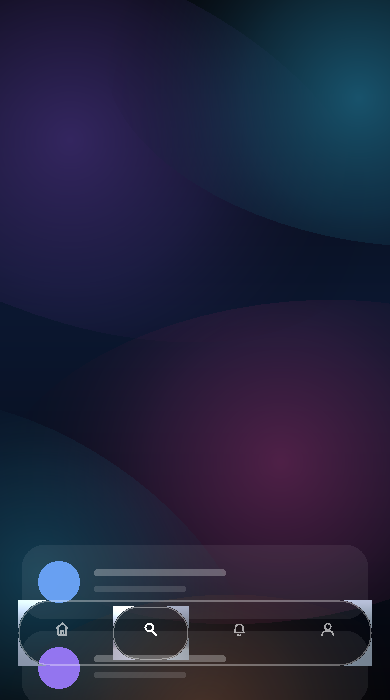

# Liquid Glass — iOS-style navigation bar for Expo Snack

A floating glass navigation bar with **real refraction**, not a translucent rectangle. It runs on
Expo's Snack runtime, so you can open it on your phone in about a minute with no local build.



Four destinations — Home, Search, Alerts, Profile — with a spring-driven selection lens and
functional navigation between them.

---

## Run it in Snack (fastest path)

1. Open <https://snack.expo.dev> (you can sign in with GitHub to save it).
2. In the **Dependencies** panel on the left, add:
   - `@shopify/react-native-skia` → **2.14.0**
   - `expo-haptics`
   - `react-native-reanimated` → **4.7.1**
   - `react-native-worklets` → **0.13.0**
   - `react-native-safe-area-context`
   - `@expo/vector-icons`

   (`expo`, `react`, `react-native` and `expo-status-bar` are already there.)
3. Replace the contents of `App.js` with **`App.singlefile.tsx`** from this repo.
4. Press **Run** and scan the QR code with Expo Go, or use the in-browser preview.

Everything is in that one file on purpose — Snack's editor is a single pane, so there are no sibling
modules to create.

### If you prefer the multi-file layout

The `src/` folder is the same code split into modules (`GlassPane`, `LiquidGlassNavBar`, `shader`,
`tokens`, …). Copy those files and `App.tsx` into a normal Expo project (`npx create-expo-app`) —
`package.json` and `app.json` here are already correct for Expo SDK 58.

---

## How the glass actually works

Most "glassmorphism" navigation bars are a blurred, semi-transparent `<View>`. That reads flat,
because it only blurs — it does not bend light. This component bends light.

Skia's `BackdropFilter` snapshots the pixels already painted behind the pane, and a **runtime shader**
(`src/shader.ts`) transforms that snapshot per pixel:

| Stage | What it does |
| --- | --- |
| SDF | Signed distance to the rounded rectangle gives the true distance from the rim. |
| Edge warp | Inside a narrow band at the rim, samples are pushed **outward** along the normal with a cubic falloff, compressing pixels into the edge — the optical squeeze of a real lens. |
| Dispersion | Red and blue are sampled at slightly different offsets, producing a faint chromatic fringe. |
| Diffusion | A cheap 5-tap blur that grows toward the rim, so the centre is crisp and the edges go soft. |
| Frost lift | The refraction is raised toward the glass's own diffuse white, which is what makes it luminous rather than a dark scrim. |
| Tint + shading | A directional white wash, a denser bottom, and a dark bevel on the lower-right arc. |
| Rim + specular | An illuminated rim that is brightest where it faces the light, plus a narrow specular band that tracks the incident angle. |

Then two things are drawn on top in primitives: a crisp 1px silhouette and a specular hairline.

### Layered depth

The selection lens is a **second** glass pane, nested inside the capsule. It refracts *the capsule's
own glass* — light that has already been bent once. That double refraction is what makes the lens
look like a solid object sitting in the bar rather than a painted pill.

### Why the bar draws the backdrop again

A `BackdropFilter` can only sample pixels already painted **on its own canvas**. So the bar's canvas
re-draws the scene (aurora field + a simplified ghost of the scrolling cards). That is deliberate:
it keeps the backdrop cheap (gradients only, no images, no blur passes), and it lets the ghost
content move on the UI thread with your scroll position, so the refraction tracks the real cards
under the glass.

---

## Interactions

- **Selection bubble** — one Reanimated shared value holds the lens position; a spring
  (`damping 17`, `stiffness 190`) drives the slide with a short, natural overshoot.
- **Liquid squash** — while travelling, the lens stretches along its motion vector and settles.
- **Icon and label** — scale, opacity and illumination are derived from that same value *inside*
  worklets, on the UI thread. A full slide costs **zero React re-renders**.
- **Touch feedback** — a 0.9 press scale and a light haptic tick when the selection changes.
- **Specular sweep** — a slow gradient highlight crossing the capsule (one draw call, no filter).

## Performance

- One shader-driven pane plus one nested lens; everything else is gradients and hairlines.
- The backdrop is gradients only, so it never allocates images or runs a blur pass.
- Scroll-driven updates go through Reanimated shared values, not React state.
- `performanceMode` on `LiquidGlassNavBar` freezes the specular sweep and softens edge diffusion
  for low-end devices — refraction, dispersion and springs stay on.

---

## Tuning it

Everything visual is in `src/tokens.ts`:

```ts
glass = {
  bar:  { tintTop, tintBottom, frost, blur, band, push, dip, chroma, rim, specular, inner, fringe },
  lens: { ... },
}
```

- `frost` — the single most important value. Raise it for a milkier, more Apple-like pane; lower it
  for clearer, more transparent glass.
- `blur` — gaussian sigma applied to the backdrop before refraction.
- `push` / `dip` / `band` — how hard and how far the rim squeezes.
- `chroma` — strength of the colour fringe.
- `layout` — capsule height, insets, icon size, label size.
- `spring` — damping / stiffness / mass of the lens.

## Using the bar in your own screen

```tsx
<LiquidGlassNavBar
  items={items}
  selected={index}
  onSelect={setIndex}
  width={screenWidth - layout.barSideInset * 2}
  canvasHeight={layout.barHeight + bottomInset + 520}
  sceneHeight={screenHeight}
  ghosts={ghostCards}
  ghostScroll={scrollY}
/>
```

Keep the bar's host canvas covering the capsule **and** the ghost content, and derive the ghost
cards from the same layout constants as your real list so the refraction lines up.

---

## Verifying the shader without a phone

`tools/preview-shader.mjs` and `tools/render-navbar.mjs` run the same SkSL through CanvasKit (Skia
compiled to WebAssembly). They are a validation step as much as a preview: if the shader has a type
error or uses an unsupported feature, `RuntimeEffect.Make` returns `null` and the script fails.

```bash
npm i -D canvaskit-wasm
node tools/preview-shader.mjs     # writes tools/out/glass-preview.png
node tools/render-navbar.mjs      # writes tools/out/navbar-preview.png
```

## Notes and limits

- The shader is compiled once at module load; if a platform ever returned `null`, `GlassPane` falls
  back to a readable opaque pane instead of an empty box.
- Blur and the runtime shader do the heavy lifting, so the visual result is near-identical on iOS
  and Android — but the *font rasteriser* for labels is the platform one, by design.
- This is a Snack/Expo demo, not a native Android module. Same code runs in a real Expo app.
